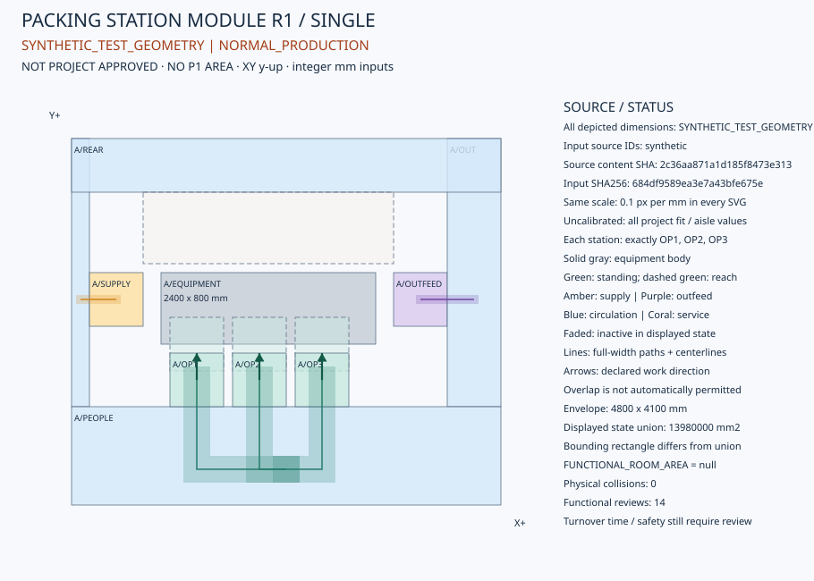

# 三人分选包装工位标准模块 R1 — 离线几何原型

TASK=`V2_2_2_OWNER_V2_THREE_PERSON_PACKING_STATION_MODULE_R1`；工作包`REVIEW-NUMERIC-CALIBRATION`。基线`6e6972e1adf012b397343bd5d53a2c65c9d81fad`。

本轮不是再次罗列缺项：已实现独立可调用的**整数毫米工位几何、四工况占用、冲突分类、完整宽度路径校核、多工位组合和SVG生成器**。示例全部实际执行，不是人工绘制或历史布局截图。

**所有示例坐标均为SYNTHETIC_TEST_GEOMETRY，不能用于设备采购、作业净空、P1面积或施工。** 正常示例的“合成几何测试通过”只表示这些输入通过所实现的几何检查，动作区、共享通道和检修仍保留REVIEW_REQUIRED；不等同于三人作业、设备能力或真实项目功能PASS。

## 直接查看

| 示例 | 工位/人员 | 查看图形 | 实际结果 |
|---|---|---|---|
| 单工位正常生产 | 1 / 3 | [正常工况](examples/synthetic-normal-operation.svg) | [结果JSON](examples/synthetic-station-result.json) |
| 单工位清洁 | 1 / 生产人员不活动 | [清洁工况](examples/synthetic-cleaning-maintenance.svg) | 同一结果的CLEANING状态 |
| 单工位检修 | 1 / 生产人员不活动 | [检修工况](examples/synthetic-maintenance.svg) | 同一结果的MAINTENANCE状态 |
| 线性组合 | 2 / 6 | [双工位](examples/synthetic-multiple-stations.svg) | [结果JSON](examples/synthetic-multiple-result.json) |
| 相向组合 | 2 / 6 | [相向工位](examples/synthetic-opposed-stations.svg) | [结果JSON](examples/synthetic-opposed-result.json) |
| 平行双排 | 4 / 12 | [双排四工位](examples/synthetic-parallel-stations.svg) | [结果JSON](examples/synthetic-parallel-result.json) |
| 项目资料缺失 | 不给项目尺寸 | [缺项提示](examples/project-input-required.svg) | [拒绝结果](examples/project-missing-result.json) |



各尺寸图统一`0.1px/mm`投影，局部/全局均为右手XY、Y向上；SVG屏幕Y向下的变换仅属于绘图，不改工程坐标。图中颜色、分层、工作方向、供料/出料/人员路径、来源标记及未校准警告均由输入生成。淡色组件在当前状态不活动；它们不会被计入该状态并集。

## 一张台及三人的空间是什么

六类组件不是面积加法系数：设备实体，三人的独立站立/动作区域，包材供给，成品/剔除物流，连续通行，以及清洁检修空间，各有实际几何、来源、活动状态和共享政策。每名人员独立记录OPERATOR_1/2/3、任务、朝向、站位、动作区及进出路径。

示例采用三人同侧的**软件测试假设**；输入模型不把同侧、相向或2+1作为真实默认。模块反复放置也不等于实际生产线已获批准。设备本体不等于模块长宽；需要额外考虑所有同时活动的作业/物流/通行空间，以及清洁检修状态。

## 算法和状态边界

- 组件采用非退化矩形，输入坐标、路径宽度和位移为整数毫米；仅接受0/90/180/270°旋转。拒绝不支持的多边形、任意角度、浮点坐标、未知组件和隐式单位，绝不先取外接框再冒充原几何。
- 所有内部运算使用整数/精确有理数。奇数路径宽度的半毫米边界保持Fraction，不用浮点容差。并集用正交扫线精确合并区间。
- 各组件先按显式局部变换，再按实例变换。接口在STATION_LOCAL中描述并与实例一起变换。组合通道在ASSEMBLY_GLOBAL中显式给定；不得从模块间距猜测通道。
- NORMAL_PRODUCTION、SHIFT_CHANGE、CLEANING、MAINTENANCE分别计算占用。设备实体在所有状态保留；清洁/检修组件和各状态通行缺失均拒绝完整几何输入。班次交接时间仍未知，不默认零耗时。
- 设备实体/站立区域相撞、设备或站立区侵占活动物流/通道为硬冲突。动作区域重叠、检修交互、供料出料交叉、共享通道及人料路径交叉分别记录REVIEW_REQUIRED，不一概允许，也不一概当实体碰撞。
- 声明共享必须给出组件、状态、条件文本和匹配的来源记录；仍不能覆盖硬碰撞或成为批准。不同状态占用同一位置只说明声明时序不同，不自动批准时序共用。
- 路径以**完整宽度、方形端帽扫掠包络**校核，不只看中心线；须被活动通道及明确指定的终端作业区域完全覆盖，且不得穿越设备实体。每人的路线必须实际进入其独立站立区内部。物料入口→供料、出料→产品出口的语义和端点同时核对。
- 多工位采用显式全局位姿、接口、组合通道及组合路线；独立核查跨工位碰撞、重复空间和人员连接。没有组合路线，不因LINEAR/OPPOSED/PARALLEL标签就推断连接；本轮不证明整线节拍、运输能力或物料连续生产线合理性。

`GEOMETRIC_UNION_AREA`、`BOUNDING_RECTANGLE_AREA`和`FUNCTIONAL_ROOM_AREA`严格区分：前二者是给定几何的诊断量；后者始终null。全状态并集是跨状态扫掠占用，不是任何一个同时运行状态，也不是整间房面积。不能采用“单模块面积×台数”代替房间布置。

## 来源与项目边界

[项目设备证据索引](equipment-evidence-index.json)限定检索仓库文档/Fixture及本项目本地资料目录，未检索其他项目或私人目录；记录候选资料SHA、适用性、版本和批准状态。已有第三方工作台、果品设备、通用清洁/工位资料仅继承为参考，不能作为本项目选型。**PROJECT_SELECTED_EQUIPMENT=UNAVAILABLE**。

调用时，本地来源文件须位于明确的evidence-root之内，实际SHA256、项目身份、证据类别和整个组件/人员/路径/位姿/共享记录均匹配。外部路径、伪Hash、未绑定的尺寸变更均拒绝。来源记录应包含哪些字段，见合成evidence JSON。原型的内容匹配不验证发布者身份、采购选型或专业签章；调用方不能填写verified/APPROVED来获得工程批准。

OWNER_PROJECT不接受SYNTHETIC_TEST_GEOMETRY来源。即使有完整PROJECT_INPUT内容匹配，仍只允许未批准几何诊断，本原型始终`MODULE_ENGINEERING_APPROVAL=NOT_APPROVED`。数据缺失时不给项目模块长宽，SVG只输出SCHEMATIC_NOT_TO_SCALE提示。

## 只读历史房间边界

[SORTING_ROOM_INTERFACE_CONTRACT](sorting-room-interface-contract.json)绑定上轮8套房间和48条接口原始内容及SHA：包材库长边→包装间短边、更衣人员、一级/二级预冷及相关工艺接口均保留。Portal是室内布置的边界输入，**不是工位进出可达性证明**。未把45.76×13.6m房间绑定到合成工位，未声明能放18台或28台。

Owner V2仍是15件×1.6kg×8小时=192kg/人·班；有来源包装成品量默认均分，可完整显式覆盖；3人/台、两班共台、台数按峰值人数、柜位按两班总人数。未改R1/R2合同、旧336规则、5.6/3.0、8.0/7.6或1.1。旧20t Canonical及P1 Hash只读重放保持。

## 可调用入口与复现

使用现有Python3.12虚拟环境。运行时模块仅依赖标准库；测试使用锁定环境已有pytest/jsonschema；未安装新依赖或服务。以下命令从仓库根目录执行，结果输出到stdout，调用者自行选择新文件保存，不会写入生产结果库：

```sh
backend/.venv/bin/python3 docs/previews/v2.2.2/owner-v2-three-person-packing-station-module-r1/offline_station_geometry.py docs/previews/v2.2.2/owner-v2-three-person-packing-station-module-r1/examples/synthetic-station-input.json --evidence-root docs/previews/v2.2.2/owner-v2-three-person-packing-station-module-r1/examples
backend/.venv/bin/python3 docs/previews/v2.2.2/owner-v2-three-person-packing-station-module-r1/offline_station_renderer.py docs/previews/v2.2.2/owner-v2-three-person-packing-station-module-r1/examples/synthetic-station-input.json --evidence-root docs/previews/v2.2.2/owner-v2-three-person-packing-station-module-r1/examples --state CLEANING
PYTHONPATH=backend/src backend/.venv/bin/python3 -m pytest docs/previews/v2.2.2/owner-v2-three-person-packing-station-module-r1/test_offline_station_geometry.py
```

`build_examples.py`可重新生成本目录合成图、合同和只读历史边界副本；默认读取已封存的设备资料索引，不依赖Mac私人路径、不重新搜索本地目录。只有显式传入`--project-data-root`才重新建立索引，本轮实际检索限本项目目录。索引反映当时文件集合；环境资料变化应形成新的索引，而不是追改历史证据。SVG/JSON同输入确定性由测试及[验证记录](validation.json)证明。文件清单和SHA见[source_manifest.json](source_manifest.json)。

## 下一步所需资料，不是自动实施授权

项目设备总图/输送连接、三人实际任务/动作/站位、周转容器及补给节拍、物流与人员通行依据、清洗/检修/交班程序和工程批准仍缺失，详见[工程缺项](engineering-missing-inputs.json)。原型不进行人体工学适配、消防/卫生符合性、墙柱净空、设备能力、施工设计或完整生产线验收。

REAL_PROJECT_MODULE_VALIDATED=false；FORMAL_MODULE_DIMENSIONS_APPROVED=false；PACKAGING_AREA_CALIBRATION_READY=false；P1_PRODUCTION_ACTIVATED=false。无真实CP-SAT/MAIN/REPLAY，无Owner Grant，无Tool7/MCP注册；P0/P1/P2及资源Authority不变。D01/D03/D04、262项UNKNOWN保留。Stage B、P3与版本未完成；交付后STOP。
