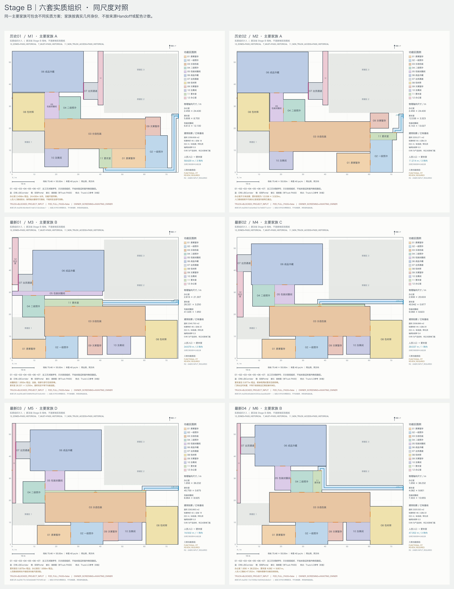
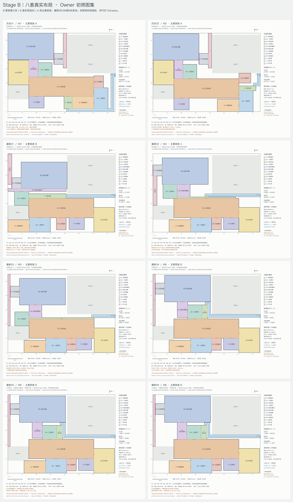
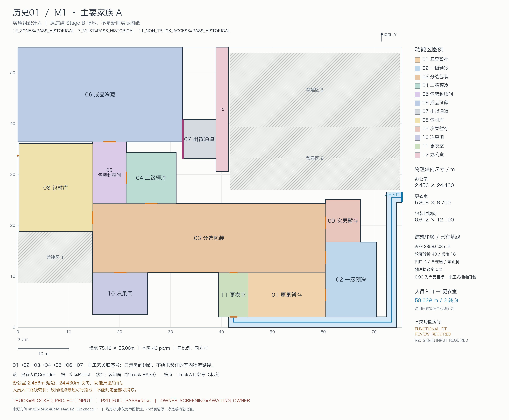
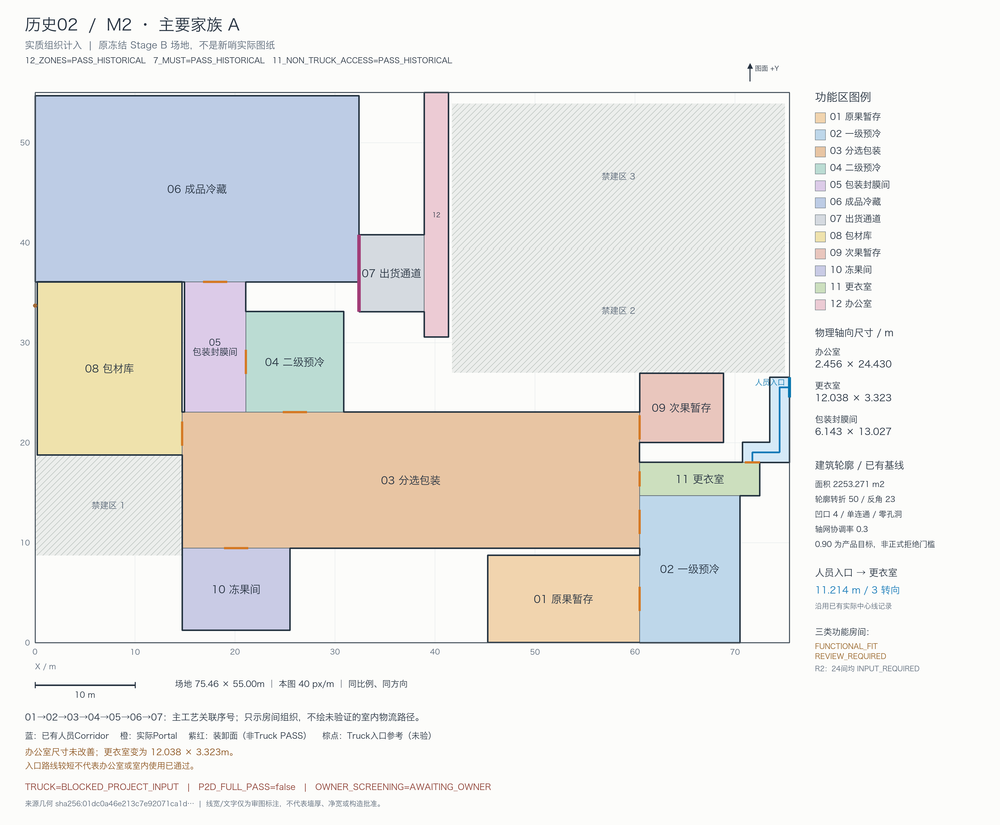
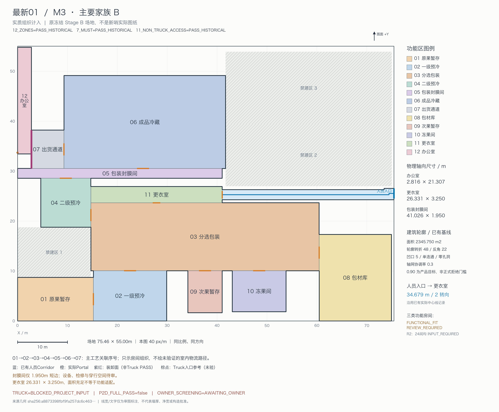
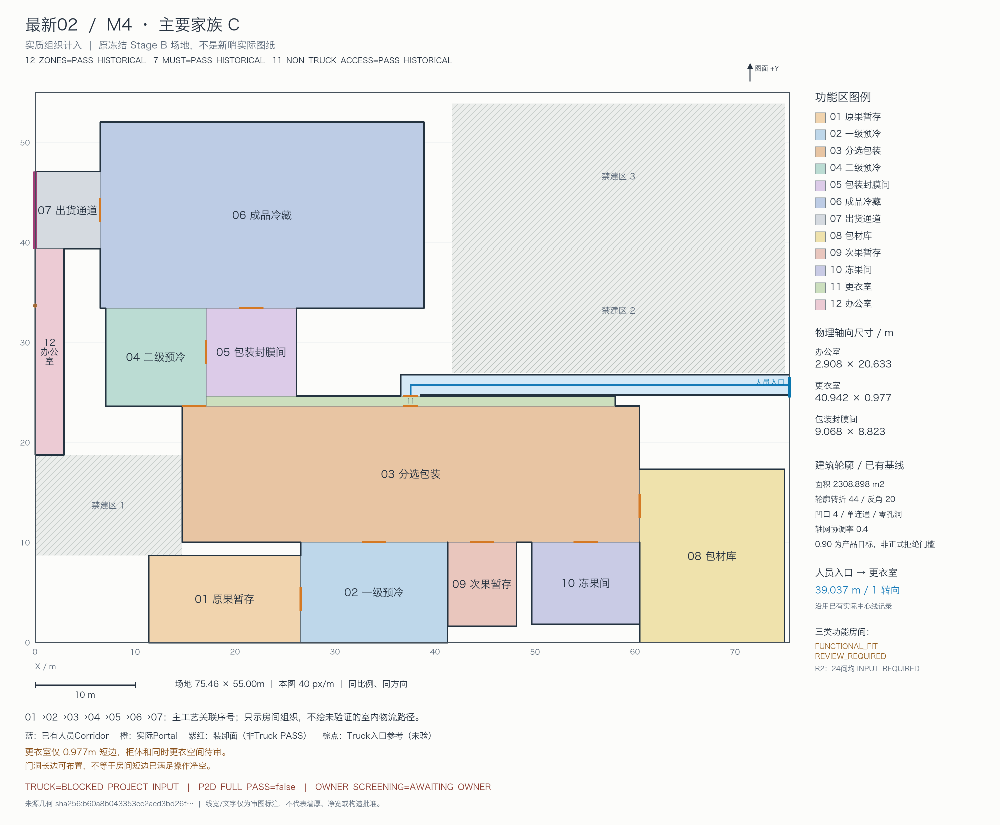
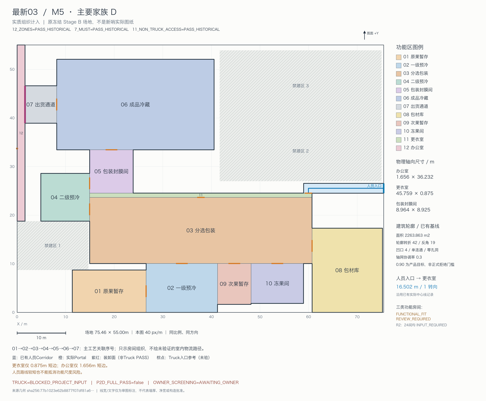
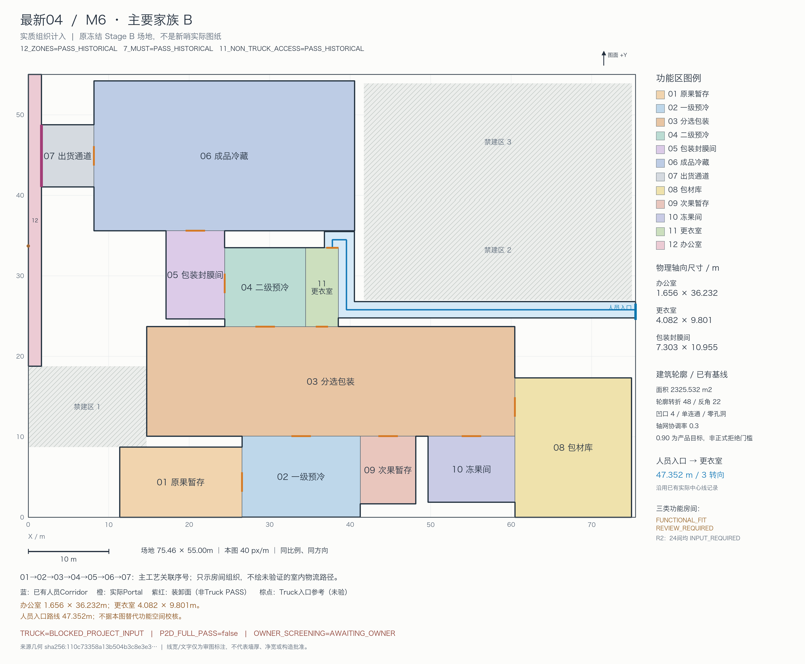
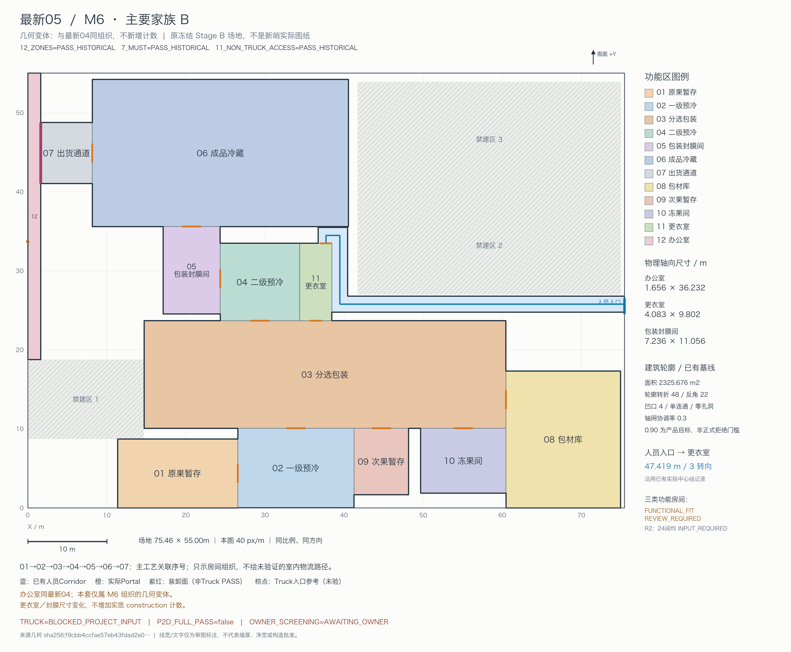

# Stage B 八套真实布局：Owner 审核图集 R1

8套物理几何、6套实质方案、4类主要结构。最新05、06是最新04的几何变体，不增加实质方案数量。

本页直接展示已经制作完成的原始PNG，未重绘、压缩或降低分辨率。全部使用冻结Stage B场地，方向、配色和同类图的世界坐标比例一致；不包含新哨实际项目图纸。

## 六套实质不同方案对照

原图分辨率：4120 × 5350。点击图片可查看完整原图。

## 八套布局总览

原图分辨率：4120 × 7040。

## 八张单套高清图

以下每张原图均为4000 × 3300。M1—M6为既有实质组织的展示别名，A—D为既有主要结构家族的展示别名，不是新增分类政策。

### 历史01 — M1 / 家族A

### 历史02 — M2 / 家族A

### 最新01 — M3 / 家族B

### 最新02 — M4 / 家族C

### 最新03 — M5 / 家族D

### 最新04 — M6 / 家族B

### 最新05 — M6 / 家族B：最新04的几何变体

### 最新06 — M6 / 家族B：最新04的几何变体

## 审核边界

每套均保留历史工程状态：12_ZONES、7_MUST、11_NON_TRUCK_ACCESS为PASS_HISTORICAL；TRUCK=BLOCKED_PROJECT_INPUT；P2D_FULL_PASS=false。本次仅发布图集，不重新执行工程验证。

图中办公室、更衣室及覆膜间尺寸、建筑轮廓、轴网和人员路线事实沿用既有质量基线。FUNCTIONAL_FIT_REVIEW_REQUIRED为待审提示，不是新长宽比硬阈值或合同FAIL。已有Portal、Corridor和装卸面不代表Truck通过；主工艺序号不代表已验证的运输路线。

Owner可逐套填写“保留／淘汰／待定”，并评价主工艺组织、功能分组、辅助房间比例及建筑轮廓。本页未代填Owner选择，也不构成最终5/3版本视觉验收、正式质量排序或工程批准。

P2D_FULL_PASS_COUNT=0；STAGE_B_COMPLETE=false；VERSION_COMPLETE=false。PR保持Draft，不Ready、不Merge、不Deploy。
